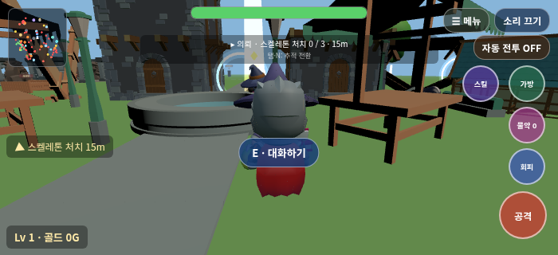
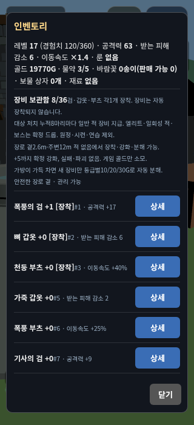
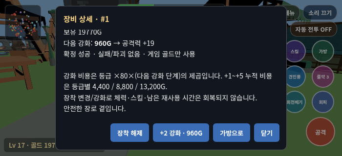
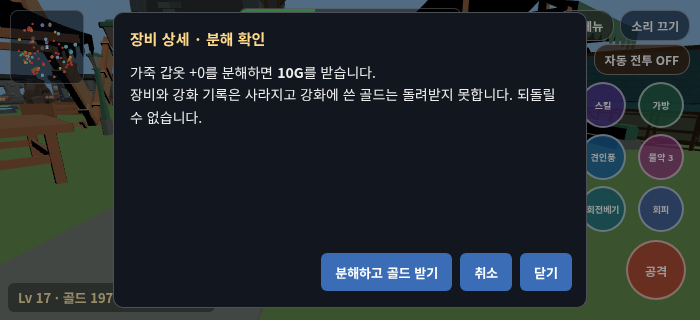

# 바람 언덕의 유랑자 (windhill-rpg)

Three.js로 만든 한국어 3인칭 탐험 액션 RPG입니다. 언덕 마을에서 의뢰를 받고 들판과 유적을 탐험하며, 적의 예고를 보고 공격·회피·원거리 기술을 조합합니다.

> 2026-11-16 장비·인벤토리·강화를 포함한 버전을 배포하고 실제 플레이 주소에서 실행·강화·저장을 확인했습니다. 배포 기준 코드는 `7917931`이며 [배포 작업](https://github.com/sigco3111/windhill-rpg/actions/runs/43767498780)이 성공했습니다. 아래 화면은 별도 설명이 없는 한 로컬 검사 버전의 실제 화면입니다. 첫 회차 20시간과 전체 다회차 자연 플레이는 검증하지 못했습니다. 배포 확인이 프로젝트 전체의 완성을 뜻하지는 않습니다.

- 저장소: https://github.com/sigco3111/windhill-rpg
- 플레이 주소: https://sigco3111.github.io/windhill-rpg/

## 주요 기능

- 언덕 마을·들판·지하묘지와 여울·기록원·고원·수로·빛의 중계소 탐험
- 메인 의뢰 20개, 선택 탐험과 반복 의뢰, 추적할 목표를 고르는 모험 일지
- 일반 공격·길게 누르는 강공격·회피·회전베기·바람칼날. 적의 가드, 돌진과 원거리 예고에 대응
- 스킬 포인트와 숙련 선택, 탐험 기록으로 여는 보법·선풍 연마·원풍 조율
- 검·갑옷·부츠 보관 및 장착, 몬스터 드롭과 의뢰 장비 보상, 게임 골드로 +5까지 확정 강화
- 전투/여정 계승으로 시작하는 새 회차, 최대 8개 회차의 독립 저장과 이전 회차 복귀
- 회차 백업 JSON 다운로드·확인 후 파일 복원, 잘못된 저장이나 다른 창의 변경 감지 시 저장 보호
- 키보드·마우스 및 모바일 터치 조작, 소리 켜기/끄기, 선택형 가벼운 화면 설정

반복 의뢰와 새 회차는 다릅니다. 새 회차는 메인 의뢰·순례길 이야기·별빛 수로 기록을 끝낸 뒤 장로 곁에서 명시적으로 선택하며, 원래 회차를 별도 슬롯에 보존합니다.

## 실행 화면

아래는 로컬 후보의 실제 화면입니다. 첫 화면은 새 저장의 시작 흐름이며 장비 화면은 준비한 검사 저장입니다. 자연 플레이 완료나 배포 확인을 뜻하지 않습니다.

### 새 저장의 첫 의뢰 (700×320)

진행을 준비하지 않은 새 저장에서 키보드로 장로에게 걸어가 첫 의뢰를 받은 화면입니다. 전체 첫 회차 검증은 아닙니다.



### 장비 보관함 (320×700)



### 강화 상세 (700×320)

본문을 아래로 스크롤한 화면입니다. 설명 영역만 스크롤되고 장착·강화·가방·닫기 버튼은 아래에 남습니다.



### 분해 전 확인



## 설치와 실행

필요 환경: Node.js **20.19 이상인 20 계열 또는 22.12 이상**, npm, Bash, curl, unzip, zip. Node 범위는 이 후보에 설치된 Vite 8.3.8의 요구사항을 따릅니다.

```bash
npm ci
bash scripts/fetch-assets.sh  # 모델·오디오·폰트와 라이선스 고지 받기
npm run dev                  # 개발 서버
npm run build                # dist/ 빌드
npm run preview              # 빌드 결과 확인
npm test                     # 장비·회차·시간의 자동 검사 57항목
```

HTML을 파일 탐색기에서 직접 여는 방식 대신 웹 서버로 실행하세요. 모델과 폰트는 외부 원본을 내려받으므로 최초 준비에 인터넷이 필요합니다. `public/assets/`, `node_modules/`, `dist/`는 소스 묶음에 포함하지 않습니다. 에셋을 받는 스크립트와 `vite.config.js`의 상대 경로 설정을 함께 보존해야 합니다.

`.github/workflows/pages.yml`의 기존 main push 배포 설정을 변경하지 않고 게시했습니다. 실제 GitHub Actions의 빌드·배포 성공과 플레이 주소의 새 번들/필수 에셋/실행을 별도로 확인했습니다.

## 조작

| 동작 | 키보드/마우스 | 터치 |
| --- | --- | --- |
| 이동 / 달리기 | WASD·방향키 / Shift | 왼쪽 스틱, 크게 밀면 달리기 |
| 시점 | 드래그 | 오른쪽 빈 곳 드래그 |
| 일반 / 강공격 | Space 또는 공격 입력, 길게 눌러 강공격 | 공격 버튼, 길게 눌러 강공격 |
| 회피 / 물약 | Q / R | 회피 / 물약 버튼 |
| 회전베기 / 바람칼날 | F / G, 기술 습득 필요 | 해당 기술 버튼 |
| 상호작용 | E | 상호작용 안내 터치 |
| 가방 / 스킬 / 메뉴 | I / K / Esc | 가방 / 스킬 / 메뉴 |

화면 안의 조작 안내와 현재 습득한 기술 표시를 함께 확인하세요.

## 장비 획득과 강화

- 검·갑옷·부츠를 합해 **36개**까지 보관합니다. 각 종류 1개를 장착하며 새 장비는 자동 장착되지 않습니다.
- 집계 대상 적 처치 누적이 8의 배수일 때 일반 적은 장비를 줍니다. 엘리트·일회성 적·보스는 확정 지급합니다. 원정 전투·시련·연습 표적은 장비 드롭 누적과 보상에서 제외합니다.
- 메인 의뢰의 4·8·11·15·18·20번째 사례에도 장비가 있습니다. 구버전 저장은 이미 완료한 해당 의뢰의 장비 보상을 한 번 소급합니다. 기존 장착 장비의 등급과 능력도 보존합니다.
- 일반 적의 드롭 등급은 대상 처치 누적 32 이전 1등급, 32 이상 2등급, 80 이상 3등급입니다. 엘리트·일회성 적은 2등급, 보스는 3등급입니다.
- 장착·해제·강화·분해는 **장로 곁 2.6m 이내이면서 주변 12m에 살아 있는 적이 없을 때** 가능합니다. 그 밖에서는 내용을 볼 수 있습니다.
- 강화는 +5까지 **확정 성공**합니다. 실패·파괴·실제 결제는 없습니다. 비용은 게임 골드로만 냅니다.
- 다음 강화 비용: `80 × 장비 등급 × 다음 강화 단계²`. 1등급 +1은 80G, 3등급 +1은 240G입니다. +1부터 +5까지 누적 비용은 1/2/3등급 각각 **4,400 / 8,800 / 13,200G**입니다.
- 강화 1단계마다 검은 공격력 +2, 갑옷은 받는 피해 감소 +1, 부츠는 이동속도 배율 +0.02가 붙습니다. 장비를 바꿔도 현재 체력이나 남은 재사용 시간은 회복되지 않습니다.
- 장착 중인 장비는 분해할 수 없습니다. 다른 장비는 확인창을 거쳐 등급별 10/20/30G로 분해합니다. 강화 비용은 반환되지 않습니다.
- 가방이 가득 차면 **새로 들어올 장비만** 등급별 10/20/30G로 자동 분해합니다. 기존 보관품이나 장착품을 버리지 않습니다.

상점의 기존 장비 단계 구매는 장비 보관·강화 안내로 바뀌었습니다. 물약 구매는 유지됩니다.

## 저장과 새 회차

저장은 이 기기의 이 브라우저에 있습니다. 브라우저 데이터를 지우거나 다른 기기로 옮기면 자동으로 따라오지 않습니다. 메뉴의 **회차 기록과 계승**에서 백업 파일을 내려받아 보관하세요.

- 전투 계승: 레벨, 기본 기술과 숙련, 보유 장비·개별 강화·장착 선택을 보존합니다. 새 회차의 골드는 0G, 물약은 3개입니다. 장비 드롭 누적과 의뢰 장비 보상 기록은 새 회차에서 다시 시작합니다.
- 여정 계승: 레벨은 보존하되 기술·장비·숙련은 새로 시작합니다. 레벨당 기본 스킬 포인트를 다시 주며 골드는 최대 500G, 물약은 3개입니다.
- 두 계승 모두 이야기·탐험·처치·일회 보상을 초기화합니다. 회차 화면의 상세 설명과 두 단계 확인을 읽은 뒤 선택하세요.
- 최대 8회차이며 오래된 회차를 자동 삭제하지 않습니다. 이전 회차로 돌아가면 그 회차만의 진행·골드·장비를 이어갑니다.
- 백업 복원은 미리보기와 확인 뒤 회차 목록 전체를 바꿉니다. 교체 전 저장을 되돌리는 기능도 제공합니다.
- 잘못된 JSON·장비 참조·다른 창의 저장 변경 등을 감지하면 기존 저장을 덮어쓰지 않고 멈춥니다. 안내에 따라 백업을 복원하거나 다시 불러오세요.

## 기술 내용

- Three.js 장면·카메라·충돌과 GLB/OBJ/FBX 모델 로더, Vite 빌드
- 실시간 전투 상태, 적별 행동·공격 예고, 풀링한 기술 이펙트
- `equipment.js`가 보유 장비·강화·획득·분해를, `save-schema.js`가 저장 형식 검사를 담당
- `cycle-store.js`가 회차별 저장·변경 충돌·슬롯 보존을, `game-clock.js`가 게임 시간을 담당
- 프레임 지연은 한 프레임 최대 0.05초만 게임 시간으로 반영합니다. 숨겨진 탭에서는 멈춥니다. **20FPS 미만에서 게임 전체가 느려질 수 있으며 성능 향상 기능은 아닙니다.**
- 선택형 가벼운 화면은 그림자와 해상도 상한을 줄입니다. 실제 모바일 기기 성능을 보장하지 않습니다.
- 오디오 재생은 브라우저 정책에 따라 첫 사용자 입력 뒤 시작합니다.

## 검사 범위와 남은 일

새 저장에서 실제 키보드 이동·장로 상점·가방·첫 의뢰 수락/재접속 흐름도 확인했습니다. 그 밖에는 로컬 브라우저에서 준비한 저장을 사용해 기존 장비 이전·완료 의뢰 소급·강화 비용·장착/해제·분해 확인·저장/재접속·회차 왕복·실제 백업 파일 복원, 실제 입력으로 일반 적 드롭·의뢰 장비 수령·가방 초과 처리·시련 장비 드롭 제외를 검사했습니다. 기존 키보드 전투와 강화 갑옷 피해 감소, 부츠 이동속도도 제한된 조건에서 확인했습니다. 화면은 320×700과 700×320에서 확인했습니다.

배포 후에도 별도 검사 저장으로 실제 사이트의 장비 이전·강화 비용/능력·장착/해제·분해 확인·저장/재접속·안전 조건 13항목을 다시 확인했습니다. 일반 주소의 기본 그래픽으로 마을과 새 보관함도 확인했습니다. 기본 그래픽 첫 로딩은 검사 환경에서 2분 이상 걸렸습니다. 실제 휴대폰의 로딩 시간이나 FPS는 확인하지 못했습니다.

다음은 완료되지 않았습니다.
- 첫 회차 20시간 플레이 목표와 전체 다회차의 자연 플레이 검증
- 모든 보스·기술 조합의 난도/골드 수급 균형, 실제 모바일 기기 장시간 성능
- 프로젝트 게임 코드에 적용할 별도 라이선스 결정

기능 수, 준비한 저장으로 통과한 검사, 게임 시간 모델은 플레이 분량이나 자연 난도를 증명하지 않습니다.

## 원작자 크레딧과 라이선스

게임 코드 자체의 별도 `LICENSE`는 아직 지정하지 않았습니다. 아래 외부 에셋 라이선스가 이 프로젝트의 모든 코드에 적용되는 것은 아닙니다.

에셋 수집 스크립트는 `sigco3111/assets-3d-lowpoly`와 `sigco3111/assets-audio`에 보관된 팩을 받습니다. 원작자와 고지는 에셋 하위 폴더의 `LICENSE-*` 파일을 따릅니다. 일부 팩은 원본 아카이브에 라이선스 파일이 없어 원본 페이지와 해시를 적은 수집 기록을 함께 둡니다.

| 사용 자료 | 원작자 | 에셋 고지 |
| --- | --- | --- |
| KayKit Adventurers / Skeletons / Forest Nature / Dungeon Remastered | Kay Lousberg | CC0, 각 폴더 LICENSE 사본 |
| Fantasy Town Kit | Kenney | CC0, `assets/town/LICENSE-fantasy-town-kit.txt` |
| Medieval Village | Quaternius | CC0, `assets/village/LICENSE-quaternius-medieval-village.txt` |
| Easy Enemy Pack | Quaternius | CC0, `assets/enemies/LICENSE-easy-enemy-pack.txt` 수집 기록 |
| RPG Audio / Impact Sounds | Kenney | CC0, `assets/audio/LICENSE-kenney-*.txt` |
| Chiptune: Exploration | ansimuz (Luis Zuno) | CC0, `assets/audio/LICENSE-chiptune-exploration.txt` 수집 기록 |
| Noto Sans KR | Adobe 및 Noto 프로젝트 | SIL OFL 1.1, `fonts/OFL-NotoSansKR.txt` |

Noto Sans KR 고지 원문: https://github.com/google/fonts/blob/main/ofl/notosanskr/OFL.txt

Three.js와 Vite 등 의존성은 각 패키지의 라이선스를 따릅니다. 이 소스 묶음은 의존성이나 외부 에셋의 권리를 새로 부여하지 않습니다.
