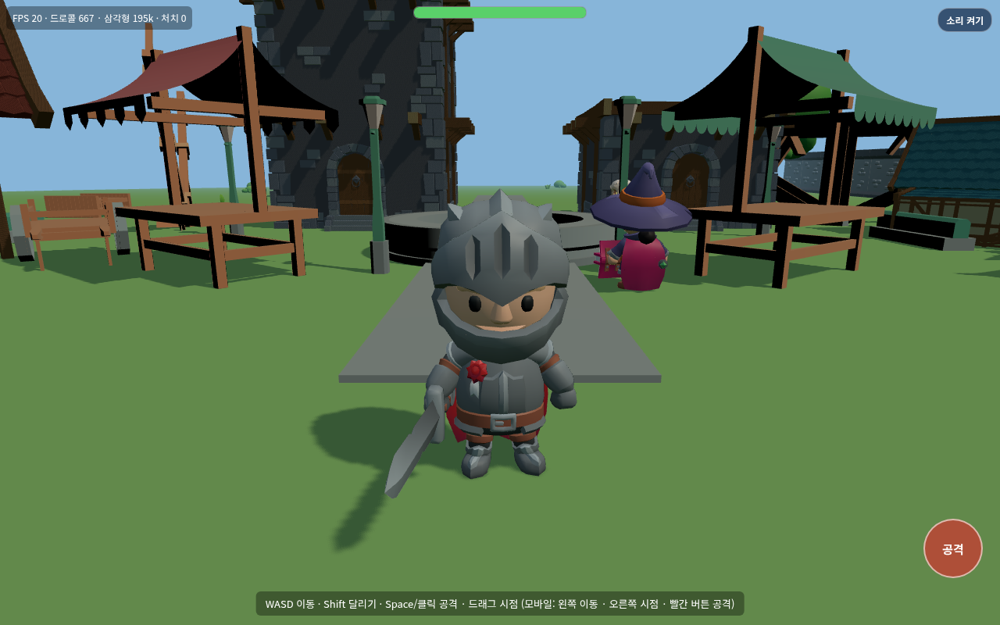
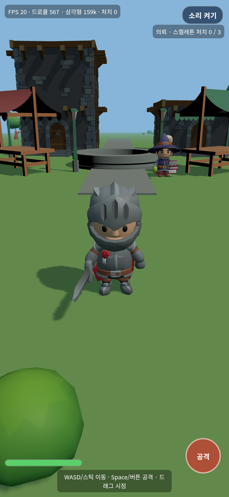

# 바람 언덕의 유랑자 (windhill-rpg)

로우폴리 3D 오픈월드 탐험 RPG. 웹(Three.js)에서 바로 실행되는 3인칭 게임.

**지금 플레이:** https://sigco3111.github.io/windhill-rpg/

## 주요 기능

- 언덕 마을과 들판, 지하묘지를 오가는 3인칭 탐험
- 장로의 의뢰 3종 연쇄(스켈레톤 처치 → 들판 몬스터 토벌 → 지하묘지 전사)와 완료 보상(최대 체력·공격력 성장)
- 실시간 전투: 스켈레톤·전사·두꺼비·쥐·거미 등 적 종류별 움직임과 애니메이션
- WebAudio 효과음·배경음악과 소리 켜기/끄기 토글
- 데스크톱(키보드·마우스)과 모바일(가상 조이스틱·터치) 조작, 세로 화면 전용 카메라
- 진행 상태(체력·공격력·의뢰) 브라우저 저장

## 실행 화면




## 설치와 실행

```bash
npm install
./scripts/fetch-assets.sh   # 에셋 내려받기 (CC0 팩)
npm run dev                 # 개발 서버
npm run build               # 배포 빌드 (dist/)
```

## 조작

- WASD/화살표: 이동 · Shift: 달리기 · Space/클릭: 공격 · 드래그: 시점
- 모바일: 왼쪽 가상 조이스틱 이동, 오른쪽 드래그 시점, 빨간 버튼 공격

## 기술 내용

- Three.js + Vite. GLB/OBJ/FBX 모델 로더와 팩별 스케일 보정(bbox 기준)
- 적 AI·애니메이션 클립은 KayKit(GLB)과 FBX 팩을 공용 래퍼로 처리
- 효과음·배경음악은 WebAudio로 합성·재생, 첫 입력 이후 활성화
- 의뢰·스탯 진행은 localStorage에 저장, 이전 버전 기록은 마이그레이션
- GitHub Actions가 에셋 수집 → 빌드 → GitHub Pages 배포까지 자동 수행

## 에셋 출처와 라이선스

에셋은 저장소에 포함하지 않고 `scripts/fetch-assets.sh`가
모델은 [sigco3111/assets-3d-lowpoly](https://github.com/sigco3111/assets-3d-lowpoly) 릴리스에서,
오디오는 [sigco3111/assets-audio](https://github.com/sigco3111/assets-audio)에서 내려받는다.
각 팩의 LICENSE 사본은 `public/assets/licenses/`에 함께 복사된다.

| 팩 | 제작자 | 라이선스 |
| --- | --- | --- |
| KayKit Adventurers | Kay Lousberg | CC0 |
| KayKit Skeletons | Kay Lousberg | CC0 |
| KayKit Forest Nature Pack | Kay Lousberg | CC0 |
| Fantasy Town Kit | Kenney | CC0 |
| KayKit Dungeon Remastered | Kay Lousberg | CC0 |
| Quaternius Medieval Village | Quaternius | CC0 (공식 팩 페이지 직접 확인) |
| Easy Enemy Pack | Quaternius | CC0 (공식 팩 페이지 직접 확인) |
| Kenney RPG Audio | Kenney | CC0 (zip 동봉 License.txt 확인) |
| Kenney Impact Sounds | Kenney | CC0 (zip 동봉 License.txt 확인) |
| Kenney Music Jingles | Kenney | CC0 |
| Chiptune: Exploration | ansimuz (OpenGameArt) | CC0 (수집 라이선스 파일 확인) |

UI 폰트: Noto Sans KR (Google Fonts, SIL OFL) — `public/fonts`에 둔다.

배포: GitHub Pages — https://sigco3111.github.io/windhill-rpg/
